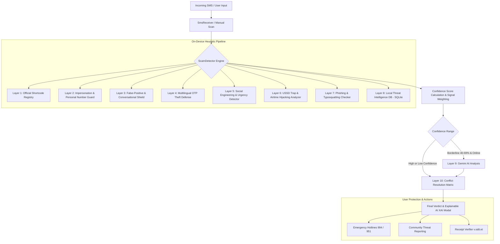

<div align="center">

# 🛡️ Meketa (መከታ) — Ethiopian Cyber Defense & Scam Shield

### _Offline-First SMS Fraud Detection, Explainable AI, and Live Bank Receipt Verification_

[](https://flutter.dev)
[](https://dart.dev)
[](#)
[](https://deepmind.google/technologies/gemini/)
[](#-testing--verification)
[](LICENSE)

<p align="center">
  <b>Meketa (መከታ)</b> is an intelligent, privacy-preserving mobile cyber-defense application engineered specifically for the Ethiopian digital ecosystem. It shields users from deceptive SMS scams, fake Telebirr & CBE transfer notifications, OTP theft, malicious USSD call-forwarding codes, and forged bank transaction receipts.
</p>

---

[Key Features](#-key-features) •
[System Architecture](#-system-architecture) •
[10-Layer Engine](#-10-layer-on-device-engine) •
[Emergency Hotlines](#-emergency-fraud-hotlines) •
[Testing & Verification](#-testing--verification) •
[Build & Setup](#-getting-started) •
[Academic Defense](#-academic--graduation-project)

</div>

---

<div align="center">
  <h3>📱 App UI Designs & Features</h3>

| Home Dashboard | Scam Alert & XAI | Threat History |
| :---: | :---: | :---: |
|  |  |  |

</div>

---

## 🌟 Key Features

### 🛡️ 1. 10-Layer Offline Threat Detection Engine
- **100% On-Device Processing:** Incoming SMS messages are intercepted and evaluated instantaneously via a weighted 10-layer heuristic pipeline without sending personal SMS to external servers.
- **Multilingual Support:** Native parsing of scam syntaxes across **Amharic (አማርኛ)**, **Afaan Oromoo**, and **English**.
- **Contextual False-Positive Shield:** Distinguishes genuine peer-to-peer transfers, personal conversations, and bank transaction alerts from spoofed sender headers.

### 🔬 2. Explainable AI (XAI) Attribution Breakdown
- **Full Transparency:** Every detection verdict produces an Explainable AI breakdown highlighting positive risk signals (e.g. Personal GSM number claiming to be a bank, demand for OTP) and negative mitigation signals (e.g. verified shortcode, standard bank notification syntax).
- **Academic Credibility:** Avoids black-box decisions by exposing weighted attribution scores and heuristic rule triggers.

### 📞 3. Emergency Fraud Hotlines Quick-Dialer
- **One-Tap Emergency Dialing:** In an active scam attempt, users can immediately dial national fraud resolution centers:
  - 🟢 **Ethio Telecom / Telebirr Fraud Hotline:** `994` *(Unauthorized transfers, fake prizes, account lock)*
  - 🟣 **Commercial Bank of Ethiopia (CBE) Contact Center:** `951` *(Fake credit alerts, transaction disputes)*
  - 🟡 **Bank of Abyssinia (BoA):** `8397` *(Apollo mobile security helpline)*
  - 🔵 **Awash Bank (AwashBirr):** `8980` *(Wallet security & fraud reporting)*
- **Clipboard Fallback:** Automatically copies numbers to clipboard on devices without active cellular dialers.

### 🤖 4. AI Security Assistant (Powered by Gemini)
- **Interactive Cyber Defense Chat:** Provides structured, complete advice in English and Amharic with markdown formatting, bullet points, and actionable safety tips.
- **Optimized Latency & Zero Token Overhead:** Configured with `thinkingBudget: 0` and 1,500 token buffers to guarantee instant, complete, and un-truncated responses.
- **Privacy-First Toggle:** Users can disable cloud AI analysis at any time, forcing 100% offline analysis.

### 🧾 5. Live & Offline Bank Receipt Verifier (v.odit.et Integration)
- **Direct Bank Gateway Verification:** Queries official upstream bank gateways (**Telebirr**, **CBE**, **Bank of Abyssinia**, **AwashPay**, **Zemen Bank**) via the `v.odit.et` API.
- **Offline Format Validation:** Uses strict regular expression checks on transaction IDs (`R...`, `FT...`, `AT...`) even when offline.
- **Duplicate Receipt Scanner:** Protects merchants and individuals from double-spending fraud by tracking previously scanned transaction references in local SQLite storage.

### ⚡ 6. USSD Threat Analyzer
- **Detects Hidden USSD Dial Strings:** Identifies deceptive codes sent in messages, such as airtime transfer codes (`*806*...`) and call-forwarding OTP hijacking codes (`*21*...`, `**21*...`).

---

## 🏗️ System Architecture



---

## ⚙️ 10-Layer On-Device Engine

| Layer | Module | Primary Defense Function |
| :--- | :--- | :--- |
| **L1** | `OfficialRegistry` | Validates genuine telecom and bank shortcodes (`994`, `127`, `806`, `889`, `898`, `899`, etc.). |
| **L2** | `ImpersonationGuard` | Flags personal numbers (`+2519...`, `09...`, `07...`) sending fake credit and debit notices. |
| **L3** | `FalsePositiveShield` | Contextually recognizes legitimate P2P transfers, greetings, and account sharing across 3 languages. |
| **L4** | `OTPDefense` | Intercepts OTP credential extraction requests while allowing valid system delivery notifications. |
| **L5** | `SocialEngGuard` | Identifies lottery claims, advance-fee traps, fake jobs, and artificial urgency. |
| **L6** | `USSDTrapDetector` | Detects airtime transfer codes (`*806*`) and call-forwarding OTP hijacking (`*21*`). |
| **L7** | `PhishingDetector` | Flags suspicious TLDs (`.xyz`, `.top`, `.tk`) mimicking official banking portals. |
| **L8** | `ThreatIntelDB` | Queries on-device SQLite database for locally verified threats and persistent fraud signatures. |
| **L9** | `GeminiAI` | Cloud second-opinion assistant with zero thinking-token overhead and local caching. |
| **L10** | `ConflictMatrix` | Resolves conflicting signals (e.g., official shortcode sending external phishing link). |

---

## 📞 Emergency Fraud Hotlines

Meketa provides instant, one-tap calling access to verified Ethiopian financial and telecom fraud hotlines:

* 🟢 **Telebirr / Ethio Telecom:** `994` (Customer Care & Fraud Inquiries)
* 🟣 **Commercial Bank of Ethiopia (CBE):** `951` (Contact Center & Emergency Fraud Support)
* 🟡 **Bank of Abyssinia (BoA):** `8397` (Customer Support & Apollo Fraud Center)
* 🔵 **Awash Bank:** `8980` (AwashBirr Customer Support & Security)

---

## 🧪 Testing & Verification

Meketa includes a comprehensive automated test suite covering all services, models, and detection layers:

```bash
flutter test
```

### Test Coverage Highlights:
- **Heuristic Detection Tests:** Legitimate bank alerts, friendly greetings, Amharic conversations, personal account sharing.
- **High-Risk Threat Tests:** Fake CBE credit alerts, Telebirr OTP demands, fake lottery traps, USSD call forwarding.
- **USSD Analyzer Tests:** Extraction of transferred amounts, recipient phone numbers, and remediation codes (`##21#`).
- **Database & Storage Tests:** SQLite CRUD, duplicate receipt detection, alert deletion.
- **Receipt Format Checker Tests:** Telebirr & CBE reference validation, QR code URL extraction.
- **VirusTotal Service Tests:** Domain heuristics, safe bank recognition, typosquatting detection.

```text
00:05 +43: All tests passed!
```

---

## 🚀 Getting Started

### Prerequisites
- [Flutter SDK](https://docs.flutter.dev/get-started/install) (`>= 3.12.0`)
- [Dart SDK](https://dart.dev/get-dart) (`>= 3.0.0`)
- Android Studio / VS Code with Flutter extension
- Android device or emulator running Android 8.0+ (API 26+)

### Installation

1. **Clone the Repository:**
   ```bash
   git clone https://github.com/amayukf/Meketa-scam-shield.git
   cd Meketa-scam-shield
   ```

2. **Install Dependencies:**
   ```bash
   flutter pub get
   ```

3. **Run Code Analysis:**
   ```bash
   flutter analyze
   ```

4. **Run the App:**
   ```bash
   flutter run
   ```

5. **Build the Release APK:**
   ```bash
   flutter build apk --release --dart-define=GEMINI_API_KEY=YOUR_GEMINI_KEY
   ```
   The built APK will be located at:
   `build/app/outputs/flutter-apk/app-release.apk`

---

## 🔑 Configuration & API Keys

API keys and service configuration are managed in `lib/config/app_config.dart`:

```dart
class AppConfig {
  static const String geminiApiKey = String.fromEnvironment('GEMINI_API_KEY');
  static const String virusTotalApiKey = String.fromEnvironment('VIRUSTOTAL_API_KEY');
  static const String oditVerifyApiKey = String.fromEnvironment('ODIT_VERIFY_API_KEY');
}
```

> 💡 **Tip:** Pass configuration keys securely at build or run time using `--dart-define`:
> ```bash
> flutter run --dart-define=GEMINI_API_KEY=your_key --dart-define=VIRUSTOTAL_API_KEY=your_key --dart-define=ODIT_VERIFY_API_KEY=your_key
> ```

---

## 🎓 Academic & Graduation Project

Meketa was engineered as a high-impact graduation project addressing the critical challenge of mobile financial fraud in Ethiopia.

### Key Academic Defense Points:
1. **Explainable AI (XAI):** Replaces opaque "black-box" decisions with transparent attribution breakdown, enabling users and examiners to inspect exact signal weights.
2. **Offline-First Resilience:** Zero dependency on constant cloud connectivity ensures defense even in remote or low-connectivity environments.
3. **Local Context Specialization:** Purpose-built for Ethiopian payment infrastructure (Telebirr, CBE Birr, AwashPay, USSD *806# airtime transfers).
4. **Privacy-Preserving Architecture:** Personal SMS messages never leave the device; external AI analysis is strictly opt-in and restricted to ambiguous payloads.

---

## 📄 License

This project is licensed under the MIT License — see the [LICENSE](LICENSE) file for details.

<div align="center">
  <sub>Built with ❤️ for Ethiopian Cyber Defense & Digital Safety</sub>
</div>
